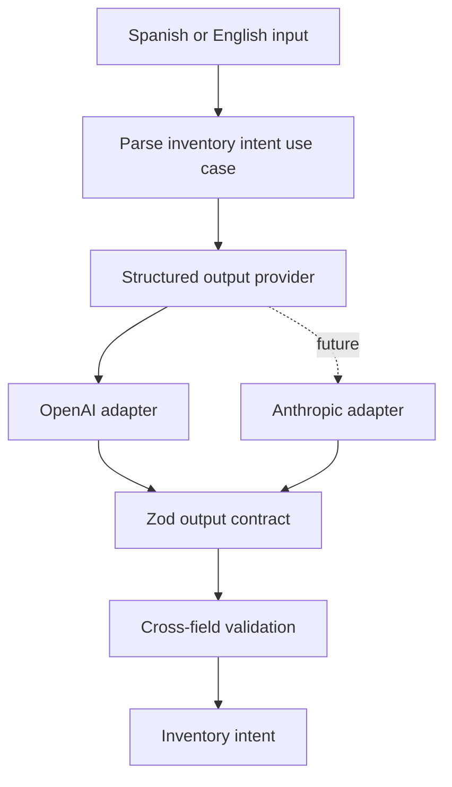

# Architecture

`inventory-intent-engine` treats the LLM as a semantic parser at the boundary between human language and domain language.

## Boundaries

- **Domain:** canonical inventory vocabulary and invariants.
- **Application:** orchestration of a parsing request.
- **AI:** prompts, provider contract, and vendor adapters.
- **Presentation:** the initial CLI entry point.

The domain does not import the OpenAI SDK. Replacing a model provider therefore does not change the inventory contract or application use case.

## Language policy

- Inputs: Spanish or English.
- Enum values and source code: English.
- Product names: preserved exactly as entered, ready for future catalog alias resolution.
- Clarification questions: returned in the detected input language.

## Current trust boundary

The engine interprets text but cannot mutate inventory. Database access, product resolution, authorization, unit conversion, and business execution are intentionally outside V1.

## Explicit interpretation context

The use case accepts a required `{ currency, referencePrices }` argument. The CLI uses demo fixtures; AXIS will supply authoritative client configuration and resolved price data later. Duplicate reference product names and inconsistent currency/basis metadata are rejected before the provider call. This is an in-memory input, not a catalog service or conversation store.

The use case revalidates provider output with Zod, then checks structural price invariants and exact reference provenance. The model-facing schema has no cross-field refinements; these checks run after the provider boundary. Application and domain still do not depend on OpenAI.

Price availability is separate from inventory completeness. An explicitly unavailable price may accompany a ready intent. Ready means ready for future domain validation, never permission to execute. Currency conflicts still require clarification. Price proposals and accepted prices remain distinct, and pending price does not imply an unpaid bill.
