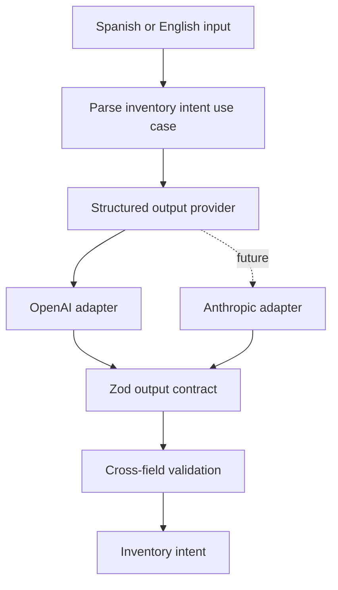

# Architecture

`inventory-intent-engine` treats the LLM as a semantic parser at the boundary between human language and domain language.

## Boundaries

- **Domain:** canonical inventory vocabulary and invariants.
- **Application:** orchestration of a parsing request.
- **AI:** prompts, provider contract, and vendor adapters.
- **Presentation:** the initial CLI entry point.

The domain does not import the OpenAI SDK. Replacing a model provider therefore does not change the inventory contract or application use case.

## Language policy

- Inputs: Spanish or English.
- Enum values and source code: English.
- Product names: preserved exactly as entered, ready for future catalog alias resolution.
- Clarification questions: returned in the detected input language.

## Current trust boundary

The engine interprets text but cannot mutate inventory. Database access, product resolution, authorization, unit conversion, and business execution are intentionally outside V1.
